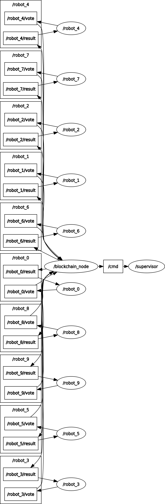

# 2023.09.12
1. 机器人记录自己的轨迹数据和特征评估数据，即三元素（时间，空间，数据特征，总体评估）
2. 机器人提交给区块链的数据为数据特征，而不是总体评估

# 2023.08.10
1. 公私钥分配，接收方先把公钥发送给发送方； :fa-check: 
2. 公钥加密数据, 私钥解密数据； :fa-check: 
3. 增加摘要，使用hash函数；:fa-check: 
4. 数字签名，使用自己的私钥签名；:fa-check: 

# 2023.08.08
1. 增加记录每个机器人的投票历史，用txt保存；[ :fa-check-square-o: ]
2. 在区块链智能合约代码同时保存使用过滤方法和不使用过滤方法的结果；[ :fa-check-square-o: ]
3. 增加实验完成后自动绘图的代码；[ :fa-check-square-o: ]

# 2023.08.07
1. 记录每个机器人投票历史，用rosbag; [可以记录，但是播放时，rosbag指令报错，需要把bag.py中的cryptodome模块换为crypto模块][注意，使用rosbag时，要安装两个包到“/opt/ros/melodic/lib/python2.7/dist-packages/”下面
- `sudo pip install pycryptodomex -i https://pypi.tuna.tsinghua.edu.cn/simple --target=/opt/ros/melodic/lib/python2.7/dist-packages/`
- `sudo pip install gnupg -i https://pypi.tuna.tsinghua.edu.cn/simple --target=/opt/ros/melodic/lib/python2.7/dist-packages/`
注意，如果报错：OSError: Cannot load native module 'Cryptodome.Cipher._raw_ecb'..., 可能是因为安装的方式错了，使用下面这个方式安装，注意pip是使用对应的是python2.7。
- `sudo /usr/bin/python -m pip install pycryptodomex --target=/opt/ros/melodic/lib/python2.7/dist-packages/`
2. 记录区块链共识后每个机器人的共识数据[已完成]
3. 记录统计结果[已完成]

# 2023.08.04
1. 已完成# 2023.08.02的四条任务
2. 

# 2023.08.02

修改代码：
1. 将supervisor与blockchain节点的通信改为ROS通信
2. 将机器人控制器与blockchian线程的通信改为ROS通信
3. 结果保存代码修改
4. controller代码改为面向对象

# 2023.06.30
1. 修改了supervisor,添加了enviroment.py;
2. 问题0630_1:blockchain部分节点不收敛,一直为false;
3. 问题0630_2:webots机器人移动过程会摇晃;